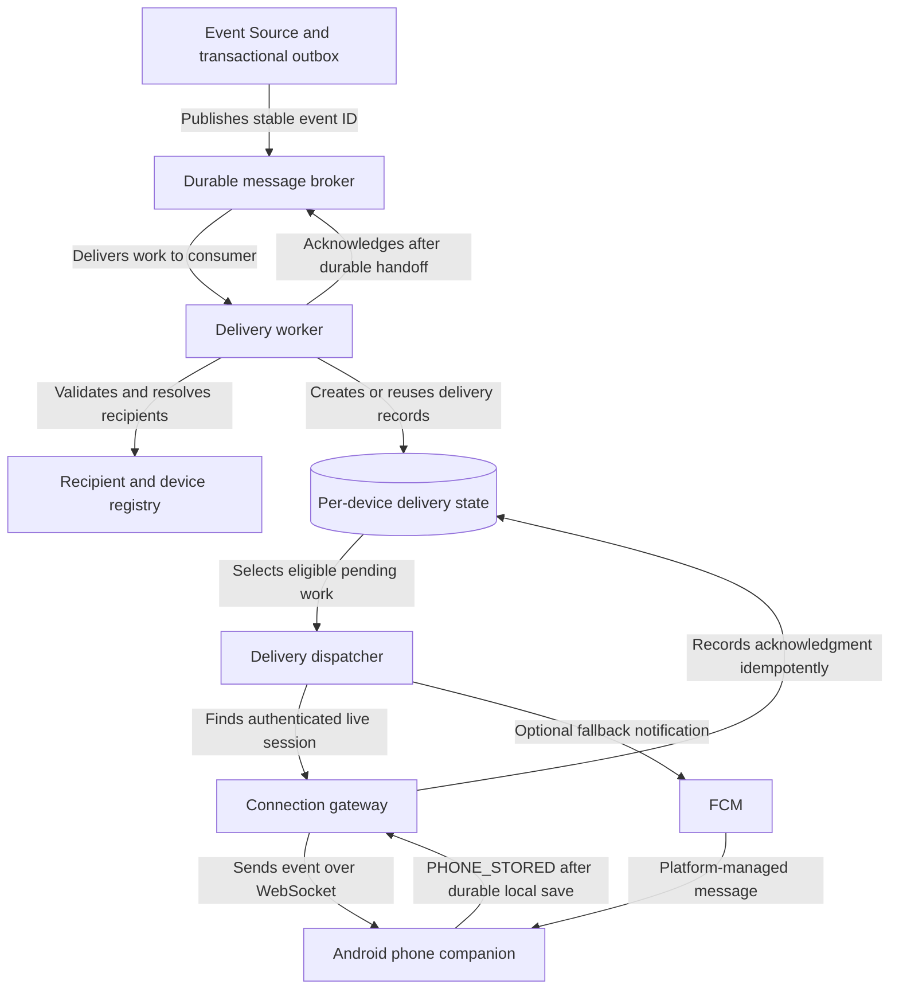

# Backend Event Delivery Design

**Project:** Clockit - Real-Time Event-to-Transaction Streaming Infrastructure
**Stage:** 2 - Backend Event Delivery Service
**Status:** Proposed design; implementation and verification pending
**Date:** 27 October 2026

## 1. Purpose

This document defines the proposed backend delivery path between the existing Event Source and the Android phone companion.

The delivery system must accept published events, resolve their intended recipients, preserve delivery work, transmit events to authenticated phones, record application-level acknowledgments, and recover safely from interrupted processing.

The design addresses unreliable mobile connectivity, phone unavailability, worker failure, duplicate delivery, delayed acknowledgments, and the assessment's target of 500,000 concurrent users.

This document describes a logical architecture, not Clockit's verified existing infrastructure. It does not require each logical responsibility to be deployed as a separate service.

### Scope boundary

**Included:**

- Durable handoff from event publication to delivery processing.
- Recipient and device resolution.
- Per-recipient delivery state.
- Live backend-to-phone transmission.
- Phone receipt acknowledgment.
- Retry, expiry, recovery, security, and operational visibility.

**Outside this stage:**

- The phone's BLE relay to the smartwatch.
- Watch receipt or presentation acknowledgments.
- Double-tap intent processing and transaction execution.

Those downstream components must consume the contracts established here without being mistaken for part of backend-to-phone delivery.

## 2. Design requirements

The design must satisfy these requirements:

1. A worker failure must not silently erase delivery work that has already been accepted.
2. Reprocessing the same published event must not create duplicate logical delivery records for the same event and device.
3. Recipient resolution must follow explicit registration and authorization rules.
4. A successful server socket write must not be reported as confirmed phone receipt.
5. A phone must acknowledge receipt only after satisfying the documented receipt condition.
6. Missing acknowledgments must trigger a defined recovery policy rather than an assumption of success.
7. Disconnected phones must have a recovery path for events that remain valid.
8. Expired events must not be replayed as though they were current.
9. Delivery state and diagnostic evidence must be sufficient to investigate delays, duplicates, retries, and failures.
10. Capacity claims must be supported by workload assumptions and measurements, not concurrent-user count alone.

## 3. Proposed logical architecture

The following components describe responsibilities. They may be combined into fewer deployable services.

The diagram is a proposed design. It does not establish that Clockit already uses a broker, WebSocket, a particular database, or FCM.

### 3.1 Event Source and publisher

The existing Event Source owns event creation, its event contract, and reliable publication.

The source design and ADR-001 establish the publication boundary, including the use of a transactional outbox when business-state changes and event publication must be coordinated.

The publisher forwards an event using its stable event identifier. Repeated publication must preserve that identity so downstream consumers can recognize duplicate attempts.

### 3.2 Durable message broker

The broker separates event publication from downstream delivery processing.

It retains work according to its configured durability and retention guarantees and supports redelivery when a consumer does not acknowledge a message.

The broker acknowledgment means that the delivery worker has safely persisted the downstream work required to continue processing. It does **not** mean that a phone received the event.

The broker product and configuration remain open pending environment constraints, operational requirements, and testing.

### 3.3 Delivery worker

The worker:

- Validates the event envelope.
- Checks that the event has sufficient routing information.
- Resolves eligible recipients and registered devices.
- Creates or reuses per-device delivery records.
- Handles duplicate publication safely.
- Acknowledges the broker message only after the required downstream work has been durably recorded.

Malformed messages and permanently invalid routing information must follow a defined failure policy. They must not be silently discarded.

### 3.4 Recipient and device registry

Recipient resolution must use authenticated application identity, device registration, and authorization rules.

The implementation must define how it handles:

- One user with multiple registered phones.
- Revoked or expired device registrations.
- Missing or invalid recipient information.
- Devices that are no longer eligible for an event.
- Events whose validity has expired before delivery.

The system must not broadcast every event to every connected phone.

### 3.5 Per-device delivery state

The delivery-state store records the status of each event for each intended device. It provides the durable record needed to retry, expire, inspect, and recover delivery work independently of the phone's current connection.

The selected storage technology remains open. The required behavior does not depend on a particular database product.

### 3.6 Connection gateway

The gateway maintains authenticated live phone sessions and provides the backend-to-phone transport.

WebSocket is the proposed live transport because it supports two-way communication over a single connection. The application protocol must supply the event identity, acknowledgment meaning, authorization, retry behavior, and recovery rules that WebSocket itself does not provide.

A successful socket write records a transmission attempt only. It must not change the delivery record to confirmed phone receipt.

### 3.7 Optional push fallback

FCM may be evaluated as a complementary notification or wake-up path when the live connection is unavailable.

An accepted FCM send request is not proof of phone receipt or application processing. The same event identity, validity rules, deduplication behavior, and application-level acknowledgment contract must apply when push is used.

FCM is not required for the initial implementation unless testing or the assessment's final design makes it necessary.

## 4. Decision 1 - Durable handoff to delivery workers

### 4.1 Options compared

| Criterion                  | Durable broker                                                             | Database-backed queue                                                                                           |
| -------------------------- | -------------------------------------------------------------------------- | --------------------------------------------------------------------------------------------------------------- |
| Worker interruption        | Supports redelivery of unacknowledged messages according to configuration  | Pending records remain available if the database transaction committed                                          |
| Duplicate processing       | Must be handled                                                            | Must be handled                                                                                                 |
| Worker coordination        | Consumer and acknowledgment mechanisms are provided by the selected broker | Claiming, locking, leases, and concurrent-worker coordination must be implemented                               |
| Per-device delivery status | Requires separate application delivery state                               | Can be represented in the queue records, although queue processing and device delivery remain distinct concepts |
| Independent worker scaling | Natural consumer model; capacity still requires measurement                | Possible, but polling, database contention, and update load require measurement                                 |
| Operational burden         | Adds a broker to configure, monitor, and operate                           | Can reuse an appropriate existing database, but adds queue-management and recovery responsibilities             |
| Assessment demonstration   | Requires broker setup and failure tests                                    | Requires safe claiming, recovery, concurrency, and load tests                                                   |

Neither approach is automatically reliable because of the technology name. The guarantee depends on the order of operations, durable persistence, duplicate handling, configuration, and failure testing.

### 4.2 Proposed decision

**Recommend a durable broker for work distribution, with persistent per-device delivery records for application-level delivery state.**

Reasons:

- It separates source publication from delivery-worker availability.
- It gives the worker pool an explicit asynchronous handoff.
- It allows processing capacity to be adjusted separately from event creation.
- Persistent delivery records provide the per-device state that broker acknowledgments alone cannot provide.

This is a proposed architectural direction, not a verified performance result or a claim about Clockit's current infrastructure.

A database-backed queue remains a valid alternative if the implementation environment lacks a suitable broker and measurements show that the database can meet the workload and recovery requirements. The design must not introduce a broker solely for architectural appearance.

### 4.3 Required handoff order

For event `E123`, the worker follows this order:

1. Receive `E123` from the broker without acknowledging it.
2. Validate the event and resolve its eligible devices.
3. Insert or reuse the logical delivery records in a database transaction. A uniqueness constraint prevents duplicate records for the same event and device.
4. Commit the transaction.
5. Acknowledge the broker message.

If the worker crashes before the database transaction commits, the broker can redeliver the event and the worker can try again.

If the transaction commits but the worker crashes before acknowledging the broker, the broker can redeliver the event. The repeated insert must reuse the existing logical delivery records rather than create duplicates.

If the broker is acknowledged before the required downstream work is durably recorded, the system risks losing the work needed to deliver the event. That ordering is prohibited by this design.

Recipient fan-out may be large. The implementation must avoid unbounded transactions or memory usage and must verify the behavior for large recipient sets. If fan-out is split into batches, the recovery protocol must ensure that unfinished batches remain discoverable and resumable.

## 5. Decision 2 - Per-device delivery record

### 5.1 Identity and uniqueness

A logical delivery is identified by the combination of the stable event ID and the intended device ID:

`(event_id, device_id)`

The pair must have a database-enforced uniqueness constraint or an equivalent atomic deduplication mechanism.

Device-level identity is necessary because a user may have multiple registered devices, and the delivery status of one phone must not incorrectly complete delivery to another phone.

The event ID must remain stable across publisher retries, broker redelivery, gateway retries, and phone acknowledgments.

### 5.2 Minimum proposed fields

| Field              | Purpose                                                                            |
| ------------------ | ---------------------------------------------------------------------------------- |
| `event_id`         | Stable identity of the published event                                             |
| `device_id`        | Intended registered device                                                         |
| `recipient_id`     | User or account to which the device belongs                                        |
| `status`           | Current delivery lifecycle state                                                   |
| `attempt_count`    | Number of recorded transmission attempts                                           |
| `last_attempt_at`  | Time of the most recent attempt                                                    |
| `next_attempt_at`  | Earliest time a retry may be attempted                                             |
| `expires_at`       | Deadline after which the event must no longer be delivered as current              |
| `lease_expires_at` | Deadline for recovering work claimed by a worker that may have failed              |
| `lease_token`      | Identifies the current worker claim so stale attempts cannot update delivery state |
| `phone_stored_at`  | Time the backend accepted a valid `PHONE_STORED` acknowledgment                    |
| `last_error_code`  | Classified reason for the most recent failure                                      |
| `created_at`       | Time the logical delivery record was created                                       |
| `updated_at`       | Time the record was last changed                                                   |

These fields form the proposed minimum. The final schema may add fields needed for payload references, priority, tracing, or retention policy after implementation constraints are known.

Sensitive event payloads should not be copied into diagnostic fields or logs. Whether the delivery store contains the payload or a reference to separately stored event data is an implementation decision that must account for retention, access control, and recovery.

### 5.3 Proposed states

| State           | Meaning                                                                                                        |
| --------------- | -------------------------------------------------------------------------------------------------------------- |
| `PENDING`       | The delivery exists and is eligible for processing when its retry time and validity allow                      |
| `IN_FLIGHT`     | A worker or dispatcher currently holds a time-limited lease to attempt delivery                                |
| `PHONE_STORED`  | The backend has accepted a valid phone acknowledgment confirming durable local storage                         |
| `EXPIRED`       | The event's delivery validity has ended before phone receipt was confirmed                                     |
| `DEAD_LETTERED` | Automated delivery attempts have stopped and operational inspection or an explicit recovery policy is required |

`IN_FLIGHT` is not permanent ownership. If the lease expires without a valid completion update, the work must become eligible for recovery.

`PHONE_STORED` records phone receipt under the defined application contract. It does not claim that the watch received or displayed the event.

`DEAD_LETTERED` must not be used merely because a phone is temporarily offline. It represents an explicitly defined terminal operational condition, such as exhausted retry policy or a permanent delivery error.

### 5.4 State transition and concurrency rules

Delivery state must be updated atomically. A worker must not read a state, make a decision from that old value, and later overwrite a newer state without checking whether its claim is still valid.

The implementation must enforce these rules:

- New eligible delivery: `PENDING`.
- Worker claims pending delivery: `PENDING` → `IN_FLIGHT`. The claim receives a unique lease token and an expiry time.
- A transient failure returns `IN_FLIGHT` → `PENDING` only if the worker still owns the current lease and the delivery has not expired.
- An expired lease makes unfinished work eligible for recovery. Recovery must replace or invalidate the previous lease token so a delayed worker cannot update the record using an old claim.
- A valid phone acknowledgment sets `phone_stored_at` and confirms receipt idempotently, regardless of whether a retry was already scheduled.
- Expiry prevents further delivery attempts. It must not cause the system to discard a valid acknowledgment for an event the phone already stored.
- Exhausting the retry policy may move a delivery to `DEAD_LETTERED`. This stops automated attempts but does not erase evidence of a phone receipt that is confirmed later.

State updates from workers must use atomic conditional updates, transactions, or equivalent concurrency controls. A worker completing an attempt may update the record only if its lease token still matches the current claim. A stale worker must not change `PHONE_STORED` to `PENDING`, overwrite a newer attempt's result, or undo another worker's confirmed receipt.

A valid acknowledgment is authoritative evidence of phone storage under the acknowledgment contract. If it arrives after the delivery was marked `EXPIRED` or `DEAD_LETTERED`, the backend must record the confirmed receipt and update the status to `PHONE_STORED`. This is a correction based on receipt evidence, not permission to retry or replay the event.

The acknowledgment handler and worker completion handler must coordinate through atomic state changes so that whichever operation runs first, a later stale worker update cannot undo confirmed receipt.

Terminal delivery states must not be reversed by stale worker updates. An explicit replay of expired or dead-lettered work requires a documented policy, including whether a new event identity is necessary.

## 6. Decision 3 - Phone receipt acknowledgment contract

### 6.1 Proposed contract

The phone sends `PHONE_STORED` only after it has:

1. Received and parsed the event.
2. Validated the event identity, schema, intended recipient/device, and validity.
3. Persisted the event in its local durable inbox.
4. Successfully committed the local database transaction.

Receiving bytes, placing an event in memory, scheduling background work, or successfully writing to a socket is insufficient.

The exact local database and Android implementation are outside this backend design's implementation scope, but the receiving contract must be honored by the phone companion.

### 6.2 Acknowledgment processing

The phone acknowledgment must contain, at minimum:

- The stable event ID.
- The acknowledgment type, `PHONE_STORED`.
- The authenticated device/session context required to verify that the sender is authorized for the delivery.

The backend must validate that the event was addressed to the device, that the acknowledgment is permitted for the current delivery, and that the event identity matches.

Repeated acknowledgments for the same event and device must be safe. Recording the same valid acknowledgment more than once must not create additional logical delivery records or corrupt the delivery state.

The backend records the acknowledgment idempotently and updates `phone_stored_at` and the delivery status according to the state-transition rules.

### 6.3 Failure cases

**Phone crashes before durable save:** no `PHONE_STORED` acknowledgment is sent. The backend retains or retries the delivery according to policy.

**Phone saves the event but crashes before acknowledgment:** the backend may retry. The phone recognizes the duplicate using the stable event identity and can acknowledge the already-persisted event again.

**Acknowledgment is lost:** the backend does not assume receipt. A retry is safe because both phone-side persistence and backend acknowledgment processing are idempotent.

**Acknowledgment arrives after expiry or dead-lettering:** If the backend receives an authenticated, valid acknowledgment matching the event and intended device, it records the confirmed receipt idempotently, even if the delivery was previously marked `EXPIRED` or `DEAD_LETTERED`. The phone must enforce the event-validity rule before storing an event. Accepting a late acknowledgment does not authorize another transmission or make an expired event eligible for replay.

**Socket write succeeds but acknowledgment never arrives:** the backend records an attempt, not confirmed receipt, and follows its retry/recovery policy.

**Phone is offline:** delivery remains pending while valid. The system does not mark the phone as having received the event.

### 6.4 Explicit boundary

`PHONE_STORED` proves only that the phone has durably saved the event according to the protocol.

It does not prove that the phone has relayed the event to the watch, that the watch has displayed it, that the user has seen it, or that a transaction has been authorized or completed. Those require separate downstream contracts.

## 7. Retry, expiry, and recovery

### 7.1 Retry policy

The implementation must define:

- Which errors are transient and which are permanent.
- Maximum attempts or maximum retry age.
- Exponential backoff and jitter where appropriate.
- The earliest permitted retry time.
- How worker leases are renewed and recovered.
- How event expiry limits retries.
- What happens when the retry policy is exhausted.

Exact numerical limits must be configuration decisions supported by requirements and testing. This design does not invent retry intervals, retention periods, or latency objectives.

Transient errors may include a temporarily unavailable phone or a recoverable connection failure. Permanent errors may include invalid event structure or an authorization failure that cannot be corrected by retrying the same request. Error classification must be explicit and observable.

### 7.2 Expiry

Events must carry, or be governed by, a documented validity policy. A time-sensitive event must not be replayed blindly after its usefulness has ended.

Before transmission and retry, the dispatcher checks validity. Expired work transitions to `EXPIRED` and is not sent as a current event.

Retention of expired records for diagnosis is separate from permission to deliver them. Cleanup must not erase records still needed for active recovery, audit, or operational investigation.

Expiry controls whether another delivery attempt is permitted; it does not erase receipt evidence. A late acknowledgment for an event already stored by the phone must be processed under the acknowledgment contract. Once expiry has passed, the dispatcher must not initiate a new transmission of that event as current. The implementation must test the race between expiry, retry scheduling, and acknowledgment processing.

### 7.3 Recovery after interruption

Recovery must cover:

- Delivery worker crash before persistence.
- Worker crash after persistence but before broker acknowledgment.
- Worker crash after claiming a delivery record.
- Phone disconnect during transmission.
- Phone receipt followed by a lost acknowledgment.
- Concurrent attempts for the same event and device.
- Large backlogs and reconnection surges.
- Expired events encountered during recovery.

The design relies on durable state, idempotent operations, uniqueness constraints, leases, and explicit acknowledgment semantics-not on assuming that any network operation happens exactly once.

## 8. Security and data handling

The implementation must enforce the following controls:

- Authenticate phone sessions before delivering events.
- Authorize each event against the intended user and registered device.
- Validate acknowledgment identity and device authorization.
- Prevent a client from acknowledging an event belonging to another user or device.
- Protect transport with appropriate encryption and certificate validation.
- Limit event payloads to the information required by the phone.
- Apply access controls and retention limits to persisted delivery state.
- Redact sensitive payloads, credentials, and personal data from logs.
- Avoid trusting recipient or device identifiers supplied by an unauthenticated client.
- Define device revocation behavior and prevent revoked devices from receiving new events.

The exact authentication provider, token format, encryption configuration, and secret-management mechanism remain implementation choices.

## 9. Observability and operations

Operational evidence must distinguish attempted transmission from confirmed phone receipt.

The system should record and expose:

| Signal                                                      | Why it matters                                                             |
| ----------------------------------------------------------- | -------------------------------------------------------------------------- |
| Published events accepted for delivery                      | Detects failure or delay at the handoff boundary                           |
| Pending delivery count and oldest pending age               | Shows backlog growth and stalled delivery                                  |
| Delivery attempts and retries                               | Reveals repeated failures and connection instability                       |
| Time from publication to `PHONE_STORED`                     | Measures the backend-to-phone delivery path                                |
| Acknowledgment latency and missing acknowledgments          | Distinguishes transport attempts from confirmed receipt                    |
| Expired and dead-lettered deliveries                        | Identifies events that could not be delivered under policy                 |
| Worker errors, lease recoveries, and broker redelivery      | Helps diagnose crashes and repeated processing                             |
| Active authenticated phone sessions and connection failures | Shows live-delivery availability                                           |
| Delivery failures by classified reason                      | Separates authorization, invalid event, transport, and processing failures |

Logs and metrics must carry stable event and delivery correlation identifiers where appropriate, without exposing sensitive payloads.

Service-level objectives, alert thresholds, metric retention, and dashboard implementation remain open until the required latency and operational expectations are defined.

## 10. Capacity and implementation constraints

The assessment specifies 500,000 concurrent users. That is a connection-capacity requirement, not a complete event-throughput specification.

Before sizing the broker, database, workers, or connection gateway, the implementation must establish or explicitly assume and test:

- Expected event rate and peak bursts.
- Average and maximum recipient fan-out.
- Number of active phone connections per user.
- Event payload size and retention needs.
- Required publication-to-phone acknowledgment latency.
- Expected offline duration and backlog size.
- Retry traffic during network outages and reconnect storms.
- Availability and recovery objectives.
- Deployment environment and available infrastructure.

The architecture must support independent measurement of connection capacity, event processing throughput, and per-device delivery latency. A design diagram or a successful small demonstration does not prove that the system can support 500,000 concurrent users.

Load and failure testing must provide the evidence for capacity claims.

## 11. Verification plan

The following are planned tests. **No test is marked as passed by this document.** Results must be recorded after actual execution, including whether the test used a simulation, a local integration environment, a physical Android device, or a real mobile network.

| Test                                                                     | Expected evidence                                                                                                    |
| ------------------------------------------------------------------------ | -------------------------------------------------------------------------------------------------------------------- |
| Worker stops before persisting downstream work                           | The unacknowledged event can be redelivered and processed without silent loss                                        |
| Worker commits delivery records, then stops before broker acknowledgment | Redelivery reuses the same logical records                                                                           |
| The same event is published more than once                               | Uniqueness and idempotency prevent duplicate logical deliveries per device                                           |
| Recipient resolution returns multiple registered devices                 | Each eligible device receives its own delivery state                                                                 |
| Recipient device is revoked                                              | Authorization rules prevent new delivery to that device                                                              |
| Phone is offline at publication time                                     | Valid delivery work remains recoverable or expires according to policy                                               |
| Server socket write succeeds but no phone acknowledgment arrives         | Delivery is not reported as `PHONE_STORED`                                                                           |
| Phone saves an event but its acknowledgment is lost                      | Retry does not duplicate the local logical event; the phone can acknowledge again                                    |
| Worker lease expires during an attempt                                   | Work becomes recoverable without allowing stale updates to overwrite newer confirmed state                           |
| Phone reconnects after an outage                                         | Still-valid events can be retried and expired events are not sent as current                                         |
| Many phones reconnect together                                           | Backlog recovery and retry traffic remain measurable and controlled                                                  |
| FCM accepts a send request                                               | The system does not treat acceptance alone as proof of phone receipt                                                 |
| Broker or delivery store becomes temporarily unavailable                 | The system preserves work according to the configured durability guarantees and exposes the failure                  |
| Event payload is malformed or unauthorized                               | The event is rejected or isolated according to policy, with a diagnostic reason and no unauthorized delivery         |
| Load test approaches the required connection target                      | Measured connection capacity, event throughput, acknowledgment latency, and failure behavior are recorded separately |

### Evidence required before declaring the stage verified

- The chosen persistence and broker mechanisms are implemented.
- The acknowledgment and retry contracts are covered by automated tests.
- Failure-injection tests demonstrate recovery at the critical operation boundaries.
- Test output and configuration are preserved in the repository.
- Any untested physical-device, OEM, or mobile-network behavior is explicitly identified as unverified.
- Capacity claims are tied to reproducible load-test evidence.

## 12. Traceability

| Assessment requirement                                | Design coverage                                                                                                                            |
| ----------------------------------------------------- | ------------------------------------------------------------------------------------------------------------------------------------------ |
| `REQ-ARCH-001` - high-level architecture              | Section 3 and the logical architecture diagram                                                                                             |
| `REQ-ARCH-002` - backend event source and handoff     | Sections 3 and 4                                                                                                                           |
| `REQ-ARCH-004` - end-to-end event-to-transaction flow | Boundary clarification in Sections 1 and 6; downstream implementation remains outside this stage                                           |
| `REQ-TEST-001` through `REQ-TEST-007`                 | Section 11 provides delivery-specific verification scenarios; exact test-to-ID mapping must follow the authoritative requirements document |

This traceability records design coverage, not implementation completion or test passage. The authoritative assessment requirements remain the source for the precise wording of each requirement.

## 13. Open decisions

The following choices remain unresolved and must be settled with implementation constraints and evidence:

1. **Broker product:** select a durable messaging system based on the available environment, required guarantees, operations, and test results.
2. **Delivery-state storage:** select a database and validate the uniqueness, transaction, concurrency, and recovery behavior required by the design.
3. **Live connection implementation:** select and test the gateway and connection-management approach.
4. **Push fallback:** determine whether FCM is required in the initial implementation or should remain a later enhancement.
5. **Retry and expiry values:** set limits using the event-validity requirements and measured behavior.
6. **Capacity targets:** establish event-rate, fan-out, payload, latency, and availability assumptions before claiming support for the concurrency target.

These are bounded implementation choices. They do not change the required guarantees: durable handoff, per-device delivery state, explicit receipt acknowledgment, safe duplicate handling, and recoverable pending work.

## 14. References

1. IETF, _RFC 6455: The WebSocket Protocol_. https://www.rfc-editor.org/rfc/rfc6455
2. Google Cloud, _Subscription overview_. https://docs.cloud.google.com/pubsub/docs/subscription-overview
3. Google Cloud, _Best practices to subscribe to a Pub/Sub topic_. https://docs.cloud.google.com/pubsub/docs/subscribe-best-practices
4. Amazon Web Services, _Amazon SQS visibility timeout_. https://docs.aws.amazon.com/AWSSimpleQueueService/latest/SQSDeveloperGuide/sqs-visibility-timeout.html
5. Firebase, _Set and manage Android message priority_. https://firebase.google.com/docs/cloud-messaging/android-message-priority
6. Firebase, _Set the lifespan of a message_. https://firebase.google.com/docs/cloud-messaging/customize-messages/setting-message-lifespan
7. AWS Prescriptive Guidance, _Transactional outbox pattern_. https://docs.aws.amazon.com/prescriptive-guidance/latest/cloud-design-patterns/transactional-outbox.html

The references establish the documented behavior of the cited technologies and patterns. The architecture, delivery schema, acknowledgment contract, and verification scenarios in this document are proposed design choices that require implementation and testing.
