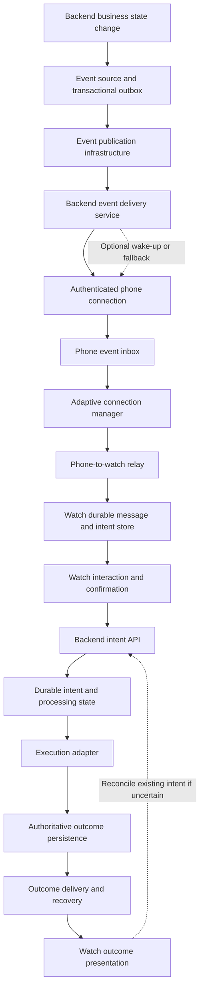

# Integrated Event-to-Transaction Architecture

**Status:** Proposed; implementation and integrated verification pending
**Date:** 28 October 2026
**Scope:** End-to-end integration of the six documented system components
**Implementation language:** TypeScript for the initial backend and connection simulation, subject to the component-specific implementation decisions already recorded

## 1. Purpose

This document defines how the six existing component designs work together to carry a backend event to a phone and watch, accept a transaction intent, process that intent, and communicate its authoritative outcome.

The integrated architecture must preserve three distinctions:

1. Delivering an event is not the same as creating a transaction intent.
2. Delivering a transaction intent is not the same as executing a transaction.
3. Executing a transaction is not the same as successfully communicating its outcome to the user.

A missing acknowledgment must not automatically cause the system to create a second transaction or claim that the original transaction failed.

This document establishes proposed system boundaries, handoff contracts, ownership, state responsibilities, recovery behavior, and verification requirements.

It does not select unverified infrastructure, claim that external financial execution is available, or establish measured reliability, latency, or capacity.

## 2. Architecture scope

The integrated system consists of six previously documented components:

1. Backend event source and publication.
2. Backend-to-phone event delivery.
3. Adaptive phone connection manager.
4. Phone-to-watch relay.
5. Watch interaction and transaction-intent initiation.
6. Backend transaction-intent processing, execution, and outcome communication.

The architecture connects these components while keeping their responsibilities separate.

### 2.1 Logical architecture

**Diagram interpretation:** The arrows show logical handoffs, not guaranteed immediate delivery. Each boundary requires a defined message contract, durable state where required, acknowledgment meaning, retry owner, and recovery path.

The diagram is logical. It does not establish that all components must be separate deployable services or that the implementation must use a particular broker, database, phone transport, or watch platform.

### 2.2 Physical deployment is not yet fixed

The first implementation may use in-process modules and simulated transports to establish deterministic behavior.

The architecture must preserve boundaries that allow later replacement with real infrastructure.

The following remain unselected until their requirements and compatibility are verified:

- Event broker and database.
- Backend deployment and worker topology.
- Phone-to-backend transport.
- Phone and watch storage implementations.
- Watch platform and physical communication mechanism.
- External transaction provider, if any.
- Production authentication, authorization, and device-association mechanisms.

A simulated execution adapter demonstrates processing behavior. It does not prove that a real external financial transaction can be executed safely.

## 3. Component responsibilities

### 3.1 Backend event source and publication

**Owns:**

- Detecting a meaningful business occurrence.
- Validating the conditions under which an event is created.
- Assigning a stable event identity.
- Persisting the event with the relevant business-state change when atomic consistency is required.
- Publishing the committed event and retrying publication when necessary.

**Does not own:**

- Phone connectivity.
- Watch delivery.
- User interaction.
- Transaction execution initiated from the watch.

**Required invariant:** Retrying publication of one occurrence preserves its event identity. A genuinely different occurrence receives a different identity.

See `docs/design/event-source.md` and `docs/decisions/ADR-001-event-publication.md`.

### 3.2 Backend-to-phone event delivery

**Owns:**

- Receiving published events.
- Resolving authorized recipient and device destinations.
- Creating and maintaining per-device delivery state.
- Delivering events through the selected authenticated connection.
- Retrying pending delivery and expiring events according to policy.
- Recording the evidence represented by phone acknowledgments.

**Does not own:**

- Watch presentation.
- Transaction-intent creation.
- Transaction execution.
- Proof that a user saw or acted on an event.

**Required invariant:** A successful socket write is not proof that the phone has durably stored the event.

The delivery service may use an optional push-notification mechanism as a wake-up or fallback path, subject to platform behavior and the selected implementation.

See `docs/design/backend-event-delivery.md` and `docs/decisions/ADR-002-backend-event-delivery.md`.

### 3.3 Adaptive phone connection manager

**Owns:**

- Tracking the backend connection lifecycle.
- Scheduling heartbeats and evaluating heartbeat responses.
- Maintaining the adaptive timeout estimate where qualified samples exist.
- Detecting suspected connection failure.
- Applying bounded reconnection backoff and jitter.
- Coordinating pending outbound items and their acknowledgments.
- Publishing lifecycle callbacks and metrics.
- Exposing network changes and simulated execution-protection observations.

**Does not own:**

- Business-event creation.
- Watch interaction rules.
- Backend transaction authorization or execution.
- The meaning of transaction success.

**Required invariant:** A phone's BLE connection to the watch does not prove that its backend connection is healthy. Evidence from one connection must not be treated as proof about the other.

The initial simulated connection must not be described as a verified Android or carrier implementation.

See `docs/design/adaptive-connection-manager.md` and `docs/decisions/ADR-003-adaptive-connection-manager.md`.

### 3.4 Phone-to-watch relay

**Owns:**

- Transferring validated messages between phone and watch.
- Maintaining pending messages according to its assigned storage responsibility.
- Retrying unacknowledged messages.
- Handling duplicate acknowledgments and duplicate messages.
- Reporting delivery evidence to the component that submitted the message.

**Does not own:**

- Backend event creation.
- The watch's final interaction decision.
- Backend transaction execution.
- Final transaction outcome determination.

**Required invariant:** A successful transport operation does not establish that the watch application has durably accepted the message.

See `docs/design/phone-to-watch-relay.md` and `docs/decisions/ADR-004-phone-to-watch-relay.md`.

### 3.5 Watch interaction and transaction-intent initiation

**Owns:**

- Recognizing the supported gesture.
- Evaluating local interaction eligibility.
- Creating or retrieving the same logical intent when the interaction is retried.
- Providing feedback that matches the strongest available evidence.
- Maintaining interaction state and diagnostic timestamps.
- Requesting reconciliation when an existing intent's outcome is uncertain.

**Does not own:**

- Backend transaction authorization.
- External financial execution.
- The authoritative transaction outcome.

**Required invariant:** A repeated delivery or retry of the same logical interaction must not automatically create a second logical intent.

A deliberate second transaction must be distinguished from a retry using an explicit interaction and business policy. That policy remains to be defined.

See `docs/design/watch-interaction.md` and `docs/decisions/ADR-005-watch-interaction.md`.

### 3.6 Backend transaction-intent processing

**Owns:**

- Receiving and validating transaction intents.
- Enforcing the server-side idempotency contract.
- Checking authorization and business eligibility.
- Persisting processing state and coordinating concurrent workers.
- Calling the execution adapter.
- Recording confirmed outcomes or explicit uncertainty.
- Making existing intent state and outcomes available for recovery.
- Communicating outcomes through the selected delivery path.

**Does not assume:**

- That receiving an intent means execution has begun.
- That a timeout proves execution failed.
- That a worker lease alone prevents duplicate external execution.
- That sending an outcome proves the watch received it.

**Required invariant:** A retry for the same logical intent must resolve to the existing intent rather than create another transaction merely because the previous response was lost.

See `docs/design/backend-transaction-processing.md` and `docs/decisions/ADR-006-backend-transaction-processing.md`.

## 4. Cross-component identity and message contracts

The architecture uses distinct identities for distinct purposes. They must not be interchangeable.

| Identity              | Purpose                                                            | Stability requirement                                                  |
| --------------------- | ------------------------------------------------------------------ | ---------------------------------------------------------------------- |
| Event ID              | Identifies one business occurrence                                 | Preserved across publication and delivery retries                      |
| Device delivery key   | Identifies delivery of an event to a particular device             | Stable for the same event-device pair                                  |
| Relay message ID      | Identifies one logical message transferred between phone and watch | Preserved across retransmission of that message                        |
| Transaction intent ID | Identifies one logical requested action                            | Preserved across intent retries and outcome recovery                   |
| Execution-attempt ID  | Identifies an attempt to execute an existing intent                | Recorded separately from the intent identity                           |
| Outcome reference     | Identifies or retrieves the authoritative result for an intent     | Must continue to refer to the same logical intent and recorded outcome |

An event ID must not automatically become the transaction intent ID. One event may lead to no action, one action, or more than one deliberate action, depending on business rules.

A retry of one intent must preserve its intent ID even if it creates a new transport message or requires a new execution attempt.

### 4.1 Event envelope

The event-source design uses a CloudEvents-style envelope containing the applicable fields:

- `specversion`
- `id`
- `source`
- `type`
- `time`
- Optional `subject`
- `data`

The application must also define event expiry or freshness policy where needed.

The envelope's exact application schema and validation rules must be established before implementation.

### 4.2 Phone-to-watch message envelope

The relay design proposes:

- `protocolVersion`
- `messageId`
- `messageType`
- `eventId`, when applicable
- `intentId`, when applicable
- `createdAt`
- `expiresAt`
- `payload`

The implementation must define which fields are mandatory for each message type. It must reject invalid or unsupported messages safely and must not interpret a missing field as permission to execute an action.

### 4.3 Transaction-intent request

The backend intent-processing boundary must receive enough validated information to identify and authorize one logical action.

The proposed contract includes:

- Stable `intentId`.
- Authenticated requester identity.
- Authorized device identity where required.
- Operation type and validated parameters.
- Relevant event or business context where applicable.
- Protocol or schema version.
- Creation time and freshness information.
- Correlation information for diagnostics.

The server must derive trusted identity from authenticated context rather than trusting an unverified identity supplied in the request body.

The exact API schema, authentication method, authorization policy, and idempotency scope remain open decisions.

### 4.4 Acknowledgment contract

Every acknowledgment must identify the object being acknowledged and define exactly what the receiver has completed.

The system must distinguish at least these milestones:

1. Event publication accepted.
2. Event delivery work durably recorded.
3. Event durably stored in the phone inbox.
4. Relay message durably stored by the watch application.
5. Transaction intent durably accepted by the backend.
6. Execution outcome durably recorded.
7. Outcome durably stored or otherwise confirmed by the receiving application, according to the selected outcome protocol.

An acknowledgment at one milestone must never be interpreted as proof of a later milestone.

The exact wire format, authentication, retry behavior, and retention policy for acknowledgments remain to be specified by the owning component designs.

## 5. Ownership of pending work and retries

The system must assign one authoritative owner to each pending-work record. Components may retain local copies, but duplicate local records must not create independent authority to invent new identities or execute a second transaction.

### 5.1 Proposed ownership model

| Pending work                                                  | Authoritative owner                                                                 | Retry responsibility                                                        |
| ------------------------------------------------------------- | ----------------------------------------------------------------------------------- | --------------------------------------------------------------------------- |
| Unpublished business event                                    | Event source/outbox                                                                 | Event publisher                                                             |
| Event delivery to a device                                    | Backend per-device delivery record                                                  | Backend delivery service                                                    |
| Phone-to-watch event message                                  | Relay pending-message store                                                         | Phone-to-watch relay                                                        |
| Watch-originated transaction intent before backend acceptance | Watch durable intent store, with phone relay retaining its transport responsibility | Watch interaction/recovery logic and relay, under a shared stable intent ID |
| Accepted transaction intent                                   | Backend intent record                                                               | Backend processing and recovery workers                                     |
| External execution with uncertain result                      | Backend intent/execution record                                                     | Backend recovery process using authoritative executor evidence              |
| Recorded outcome not yet communicated                         | Backend outcome record or durable delivery record                                   | Backend outcome delivery service                                            |
| Outcome not yet received by the watch                         | Watch's existing intent state plus backend outcome retrieval                        | Selected outcome delivery and reconciliation mechanism                      |

This table establishes logical ownership. The exact storage and transfer mechanics remain subject to implementation.

### 5.2 Ownership transfer rule

When a component hands work to another component, it must not assume that a transport call alone transfers responsibility.

The receiver must first establish the required durable state or provide the acknowledgment defined by the handoff contract.

The sender may then update its own pending state according to that contract.

Where the receiver and sender share durable storage, the implementation must define the atomic state transition that replaces a separate acknowledgment.

### 5.3 Phone inbox and relay boundary

The phone event inbox and relay must not independently retry the same work without a shared identity and explicit responsibility.

The implementation must select and document one of these approaches:

- The relay owns its own durable copy and acknowledges the inbox only after the relay has committed that copy.
- The inbox and relay use shared durable storage with an explicit atomic ownership or processing-state transition.

The implementation must not silently delete the inbox item after a socket or BLE write.

The selected approach must be tested across interruption and restart.

## 6. End-to-end lifecycle

### 6.1 Event creation and publication

1. A backend business operation changes authoritative business state.
2. The event source validates whether the change qualifies for publication.
3. The source creates a stable event identity and persists the event.
4. Where atomic consistency is required, the business change and event record are committed together.
5. The publisher reads committed events and attempts publication.
6. Failed publication remains recoverable under the publisher's retry policy.

A publication acknowledgment proves only the milestone defined by the publication infrastructure. It does not prove that a phone or watch received the event.

### 6.2 Backend delivery to the phone

1. The delivery service receives a published event.
2. It validates the event and resolves the authorized recipient and destination devices.
3. It records per-device delivery work durably before acknowledging the upstream handoff when that is the selected design.
4. The dispatcher attempts delivery over the authenticated connection.
5. The phone validates the event, identity, recipient, device, schema, and expiry.
6. The phone commits the event to its durable inbox.
7. The phone sends `PHONE_STORED` only after that durable commit.
8. The backend records the acknowledgment against the correct event-device delivery record.

A late acknowledgment must be handled idempotently. It may provide valid evidence that storage occurred, but must not automatically authorize a new delivery or revive an expired item beyond its policy.

### 6.3 Phone connection recovery

1. The connection manager tracks the current connection state.
2. Qualified heartbeat observations update the learned timeout according to the component's estimator rules.
3. Missing heartbeat responses trigger the configured suspicion and failure policy; they do not prove why the connection failed.
4. The manager reconnects using bounded exponential backoff and jitter.
5. After reconnecting, it verifies that the application connection is usable.
6. Pending items are reconciled by stable identity.
7. Acknowledged items are completed; unacknowledged items follow the retry and expiry policy.
8. Recovery is observable through lifecycle callbacks and metrics.

Android scheduling restrictions and manufacturer-specific behavior may delay recovery. The architecture must not promise that a JavaScript or TypeScript timer executes on schedule when the host process is suspended.

### 6.4 Phone-to-watch event delivery

1. The phone submits a validated event to the relay.
2. The relay records the message according to its selected durability contract.
3. The transport attempts to deliver the message.
4. The watch validates the envelope and message.
5. The watch durably stores the message before acknowledging application receipt.
6. The relay records the acknowledgment.
7. Duplicate delivery returns an idempotent result rather than creating duplicate logical messages or actions.

A successful BLE write, Data Layer message send, or other transport operation is not by itself proof of durable application receipt.

### 6.5 Watch interaction and intent creation

1. The user performs the supported interaction.
2. The watch checks local eligibility and recognizes the gesture.
3. The application creates or retrieves the stable logical intent.
4. The intent is persisted according to the agreed storage guarantee before the UI claims durable acceptance.
5. The watch submits the existing intent through the phone and selected backend path.
6. Retries preserve the same intent identity and equivalent parameters.
7. A request with the same intent ID but conflicting parameters is rejected and reported rather than treated as a new action.

The watch may show that an intent is queued or submitted only when the relevant evidence exists. It must not show transaction success merely because a tap was recognized or a request was sent.

### 6.6 Backend processing and execution

1. The backend authenticates the request and validates its schema.
2. It checks authorization, business eligibility, freshness, and required parameters.
3. It atomically creates or retrieves the intent using the stable identity.
4. It rejects conflicting reuse of the same intent ID.
5. It coordinates concurrent processing workers using the selected claim, lease, or equivalent mechanism.
6. It advances the intent through permitted state transitions.
7. The execution adapter submits or simulates the execution according to the selected environment.
8. The backend records confirmed success, confirmed failure, or explicit uncertainty based on available evidence.
9. The backend makes the recorded result available for outcome delivery and reconciliation.

A worker claim does not by itself guarantee that an external provider will execute an operation only once. Where supported, the execution adapter must use a stable idempotency key and authoritative status lookup. Where those guarantees are unavailable, the backend must preserve uncertainty instead of blindly resubmitting an operation that may already have taken effect.

### 6.7 Outcome communication and recovery

1. The backend records the authoritative outcome before claiming that it is durably available.
2. The outcome service attempts to communicate the result through the selected delivery path.
3. The receiving application associates the outcome with the existing intent ID.
4. The watch validates the result and updates its displayed state.
5. A missing outcome acknowledgment triggers retry or retrieval of the existing result, not creation of a new transaction.
6. If the execution result itself is uncertain, the backend performs the defined reconciliation process before changing the state.

A recorded success followed by failed notification delivery remains a successful transaction with a communication problem. Those are separate conditions and must be represented separately.

## 7. Integrated state responsibilities

There is no single state variable that adequately represents the entire system. Each component owns its own state and communicates evidence across boundaries.

| State domain       | Examples                                                                        | Authoritative owner                                                |
| ------------------ | ------------------------------------------------------------------------------- | ------------------------------------------------------------------ |
| Business event     | Created, published, expired                                                     | Event source/publication record                                    |
| Device delivery    | Pending, in flight, phone stored, expired                                       | Backend delivery service                                           |
| Backend connection | Connecting, connected, suspected failure, reconnect wait                        | Phone connection manager                                           |
| Relay message      | Pending, awaiting acknowledgment, acknowledged, expired                         | Relay pending-message store                                        |
| Watch interaction  | Ready, intent created, waiting, outcome unknown                                 | Watch interaction store                                            |
| Transaction intent | Accepted, processing, execution in progress, succeeded, failed, outcome unknown | Backend intent record                                              |
| Outcome delivery   | Pending, attempted, acknowledged or unresolved                                  | Backend outcome-delivery record and receiving application evidence |

The implementation must not collapse these states into one generic `success` or `failed` flag.

For example, the phone may be connected while the watch is disconnected; a transaction may be successful while the watch still shows an unknown outcome; or the watch may have stored an event while the backend still awaits the phone's acknowledgment.

## 8. Failure handling and recovery

### 8.1 Failure classification

| Failure                                 | Required response                                                                              | Evidence required for recovery                                                            |
| --------------------------------------- | ---------------------------------------------------------------------------------------------- | ----------------------------------------------------------------------------------------- |
| Event publisher loses connection        | Retain committed event and retry publication                                                   | Publication acknowledgment for the same event ID                                          |
| Phone becomes unreachable               | Retain pending device delivery and retry within policy                                         | Valid `PHONE_STORED` acknowledgment                                                       |
| Phone process is killed                 | Reconnect and reconcile durable pending state when execution resumes                           | Recovered connection and item-level acknowledgment                                        |
| BLE connection drops                    | Retain relay work and re-establish transport                                                   | Watch application acknowledgment                                                          |
| Watch process stops                     | Recover stored messages and intents on restart                                                 | Existing identities and durable state                                                     |
| Intent request response is lost         | Retry or query the same intent                                                                 | Backend record for the same intent ID                                                     |
| Two workers process one intent          | Coordinate state transitions and execution claims                                              | Concurrency-safe persistence and executor evidence                                        |
| Worker resumes after claim expiry       | Reject stale state updates and prevent unsafe duplicate submission through executor safeguards | Claim identity, execution identity, and authoritative execution status                    |
| Execution request times out             | Preserve uncertainty when execution status is not established                                  | Authoritative provider or simulator evidence                                              |
| Execution succeeds but response is lost | Recover the existing execution result                                                          | Existing intent and execution identity                                                    |
| Outcome notification fails              | Retry or retrieve the existing outcome                                                         | Durable outcome record and delivery evidence                                              |
| Event or intent expires                 | Apply the relevant component's expiry policy                                                   | Evidence that expiry occurred before an irreversible execution submission, where required |

### 8.2 Timeout and expiry rules

A timeout is evidence that an expected response did not arrive within the configured period. It is not proof of the cause.

The implementation must distinguish:

- Connection timeout.
- Heartbeat response deadline.
- Event expiry.
- Relay message expiry.
- Intent freshness limit.
- Execution response timeout.
- Outcome communication timeout.

Each timeout must have a defined owner, trigger, state transition, and recovery behavior.

An event may become stale and no longer authorize a new action. An intent that may already have been submitted for execution must not be marked expired merely to hide an uncertain result.

### 8.3 Retry safety

Every retry policy must specify:

- What is retried.
- Which component owns the retry.
- The stable identity preserved by the retry.
- Whether the receiver can process duplicates safely.
- The retry limit, delay, and expiry behavior.
- What evidence completes the pending work.
- What happens when the result remains uncertain.

The design does not promise global exactly-once delivery or execution. It aims for durable recovery, stable identities, idempotent processing, and explicit uncertainty.

## 9. Security boundaries

Each boundary must authenticate the sender, validate the message, and authorize the requested operation according to its role.

The integrated implementation must define:

- Device enrollment and revocation.
- Phone and watch association.
- Authenticated backend connections.
- Message integrity and replay handling.
- Event and intent recipient authorization.
- Transaction authorization at the backend.
- Protection of credentials and sensitive payloads.
- Expiry and stale-message handling.
- Audit records for material state transitions.

Pairing a watch with a phone does not by itself authorize a financial action. A correctly signed or authenticated message does not bypass server-side business rules.

The exact security mechanisms depend on the selected platform and deployment. They must be decided and verified before production use.

## 10. Observability and diagnosis

The system must be able to trace one event and any resulting transaction intent across component boundaries without conflating their identities.

### 10.1 Correlation fields

Subject to the final telemetry and privacy schema, records should include applicable fields such as:

- `eventId`
- `deviceId`
- `messageId`
- `intentId`
- `executionAttemptId`
- Component name and version.
- State before and after a transition.
- Timestamp and elapsed duration.
- Attempt number.
- Acknowledgment milestone.
- Failure classification.
- Retry and recovery reason.

Sensitive transaction payloads, authentication secrets, and unnecessary personal data must not be copied into general-purpose logs.

### 10.2 Required timing points

For the double-tap and delayed-delivery diagnostic scenarios, capture the stages that can be measured:

1. Gesture recognized.
2. Intent durably created.
3. Intent submitted by the watch.
4. Phone receives and stores the intent.
5. Backend receives the request.
6. Backend accepts the intent.
7. Execution submission begins.
8. Authoritative execution result becomes available.
9. Outcome delivery begins.
10. Watch receives and processes the outcome.

Cross-device timestamps may have clock skew. Duration calculations should use monotonic clocks within a process where possible and must not assume synchronized wall clocks across devices.

### 10.3 Required connection and delivery metrics

The component designs define initial metrics, including learned timeout, consecutive connection failures, heartbeat round-trip time, delivery attempts, and acknowledgment state.

The integrated system should also measure:

- Pending work count and age.
- Delivery and acknowledgment latency.
- Reconnection duration and attempts.
- Expired and dead-lettered items.
- Duplicate deliveries and idempotent replays.
- Intent processing duration.
- Execution uncertainty count and age.
- Outcome delivery delay.
- Recovery completion and unresolved recovery cases.

Metric names, labels, sampling, retention, and alert thresholds remain implementation decisions.

## 11. Performance and capacity

The assessment requires consideration of 500,000 concurrent users under varied mobile-network conditions and manufacturer restrictions.

This design does not claim that the proposed system has been measured at that scale.

Capacity evaluation must account for:

- Active connections and per-connection memory.
- Heartbeat frequency and response deadlines.
- Reconnection storms after outages.
- Durable queue and outbox growth.
- Delivery-worker concurrency and downstream limits.
- Database writes and acknowledgment volume.
- Retry traffic during prolonged outages.
- Outcome recovery traffic.
- Device and network conditions that delay client execution.

The implementation must state its workload assumptions, show its capacity calculations, and measure resource consumption in a reproducible test environment.

Heartbeat and reconnect settings must be selected from evidence rather than presented as universally correct values.

## 12. Verification strategy

The integrated architecture is a proposed design. Its correctness remains unverified until implementation and tests produce evidence.

Verification must combine component tests, integration tests, failure injection, and the appropriate device or scale tests.

### 12.1 Integrated handoff tests

- A committed event remains publishable after publisher interruption.
- A duplicate event publication does not create a second logical event.
- A delivery record survives worker restart.
- The phone acknowledges an event only after durable inbox storage.
- Interrupt the phone process between inbox storage and relay handoff; after restart, verify that the event remains recoverable and that ownership transfer does not lose work or create independent duplicate processing.
- A relay retry preserves the message identity.
- A watch retry preserves the intent identity.
- A repeated request resolves to the same backend intent.
- Conflicting parameters under the same intent ID are rejected.
- Concurrent workers cannot independently advance the same intent through an unsafe execution path.
- A stale worker cannot overwrite newer authoritative state.
- An uncertain execution is reconciled rather than blindly resubmitted.
- A recorded outcome remains recoverable after notification failure.
- Duplicate and late acknowledgments are handled according to the relevant state contract.

### 12.2 End-to-end failure tests

- Backend connection drops while an event is pending.
- Phone process dies after receiving an event but before acknowledgment.
- Phone loses its watch connection while a message is pending.
- Watch process stops during intent submission.
- The backend accepts an intent but its response is lost.
- Execution completes but the backend response is lost.
- An execution worker resumes after its claim expires.
- The outcome is persisted but the watch is unreachable.
- The connection returns after an extended outage and many items are pending.
- A stale event or intent arrives after its allowed freshness period.

For each test, record the initial state, injected failure, expected state transitions, observed results, duplicate behavior, recovery evidence, and unresolved limitations.

### 12.3 Environment distinctions

Results must identify whether they came from:

- Unit tests with simulated dependencies.
- Integration tests using local services.
- Android emulator tests.
- Physical phone and watch tests.
- Actual mobile-network or carrier tests.
- Load and capacity tests.

A simulated transport result cannot be reported as physical-device proof. An emulator result cannot establish behavior on every Android manufacturer. A successful small load test cannot establish capacity for 500,000 concurrent users.

The assessment's five African mobile-network failure modes and the specific diagnostic scenarios must be documented and verified in their dedicated artifacts.

## 13. Requirement traceability

This design contributes to the following requirements:

| Requirement group                       | Design contribution                                                         | Verification still required                                        |
| --------------------------------------- | --------------------------------------------------------------------------- | ------------------------------------------------------------------ |
| `REQ-ARCH-001`                          | Integrated architecture diagram and component boundaries                    | Review against all required architecture elements                  |
| `REQ-ARCH-002`                          | Event creation, publication, delivery, and acknowledgment boundaries        | Publication and delivery tests                                     |
| `REQ-ARCH-003`                          | Connection-manager responsibility and recovery integration                  | Heartbeat, reconnection, lifecycle, and process-interruption tests |
| `REQ-ARCH-004`                          | End-to-end intent, execution, uncertainty, and outcome lifecycle            | Double-tap, duplicate, interruption, and outcome-recovery tests    |
| `REQ-CONN-001` through `REQ-CONN-011`   | Connection-manager integration and platform boundaries                      | Component tests and applicable platform verification               |
| `REQ-DIAG-001` through `REQ-DIAG-005`   | Failure classification, diagnostic timestamps, and recovery evidence        | Reproduction, diagnosis, corrective-action, and retest evidence    |
| `REQ-TRADE-001` through `REQ-TRADE-003` | Boundaries where delivery strategy and connection choices affect the system | Explicit trade-off analysis and evidence                           |
| `REQ-SCALE-001`                         | Capacity factors and measurement requirements                               | Documented assumptions, calculations, and scale-test results       |
| `REQ-TEST-001` through `REQ-TEST-007`   | Integrated verification strategy                                            | Executed tests, environment details, and results                   |
| `REQ-TRACE`                             | Explicit mapping from architecture to verification evidence                 | Updated traceability artifact with truthful statuses               |

Documenting a requirement in this design does not make that requirement implemented or verified. The traceability artifact must preserve the actual status and evidence for each requirement.

## 14. Unresolved decisions

The following decisions must be resolved at the appropriate component or integration stage:

1. Event broker, outbox storage, and publication configuration.
2. Backend delivery transport, acknowledgment authentication, and optional push-notification behavior.
3. Phone inbox and relay pending-work ownership and atomic handoff mechanics.
4. Target watch platform and the selection of BLE GATT, Wear OS Data Layer, or another supported transport.
5. Relay wire schema, storage guarantee, expiry, and retry policy.
6. Transaction-intent API schema, authentication, authorization, and idempotency scope.
7. Execution adapter behavior, external provider capabilities, and authoritative status lookup.
8. Concurrent execution coordination and the handling of stale workers.
9. Outcome delivery channel, acknowledgment contract, and reconciliation strategy.
10. Concrete timeout, retry, retention, and backoff parameters.
11. Production telemetry schema, privacy controls, and alert thresholds.
12. Physical-device, carrier, manufacturer-specific, and scale-test environments.

These are not all decisions that must be settled before the first deterministic simulation. They must, however, be resolved before the implementation depends on the corresponding behavior.

## 15. Acceptance criteria for the integrated design

The design review is complete only when:

- Every component has a clear responsibility and explicit boundary.
- Every handoff defines identity, acknowledgment meaning, and failure behavior.
- Pending-work ownership and retry responsibility are explicit.
- Event identity, message identity, intent identity, and execution-attempt identity remain distinct.
- Duplicate delivery and missing responses do not automatically create new transactions.
- Transaction uncertainty and outcome communication failure remain distinguishable.
- The design identifies its unverified assumptions and open decisions.
- Each applicable requirement maps to an intended design element and later verification evidence.
- The architecture makes no unsupported claim of exactly-once execution, physical-device reliability, or production-scale capacity.

**Current verification status:** This document defines the proposed integration. No integrated implementation, end-to-end test results, physical-device results, carrier results, or 500,000-user capacity measurements are claimed.
